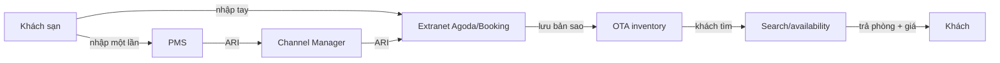
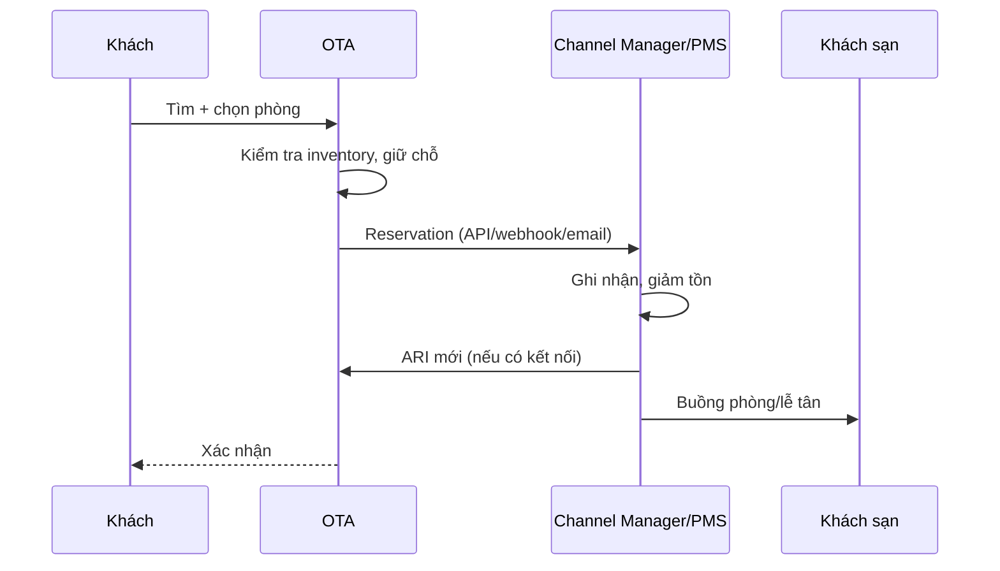
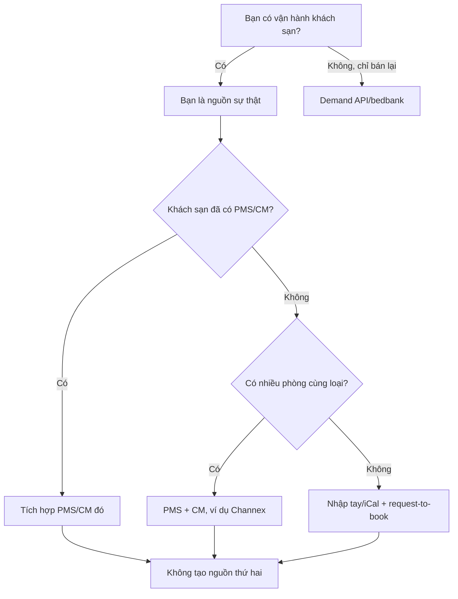
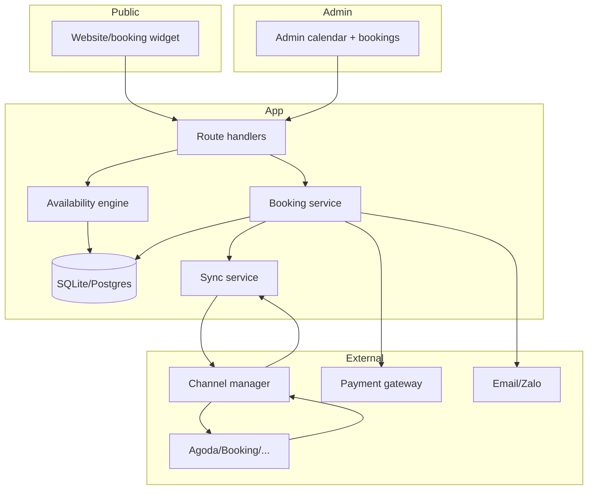

# Khảo sát & kế hoạch: tồn phòng Agoda/Booking cho app khách sạn nhỏ

> Ngày lập: 02/11/2026. Đây là tài liệu nghiên cứu và đề xuất kỹ thuật, chưa phải đặc tả cuối cùng.
> Điều kiện API, giá và chính sách của OTA/nhà cung cấp thay đổi theo thời gian; phải xác nhận lại trước khi ký hợp đồng hoặc cam kết tiến độ.

## 0. Kết luận ngắn

1. **OTA không tự “dò” phòng trống.** Khách sạn, PMS hoặc channel manager khai báo Availability – Rates – Inventory (ARI). OTA lưu một bản sao, rồi tính số phòng còn bán được khi khách tìm.
2. **Không có API công khai để đọc tồn phòng trong extranet của một khách sạn nhỏ.** Muốn lấy/ghi dữ liệu hợp lệ phải đi qua một trong ba cửa: channel manager/PMS API, chương trình Demand/Affiliate API, hoặc iCal/nhập tay.
3. **Khách sạn 6–30 phòng thường có nhiều phòng trong cùng một loại phòng.** iCal không biểu diễn được “còn 2/5 phòng”; muốn đồng bộ OTA gần thời gian thực thì cần channel manager.
4. **Nếu khách sạn đã dùng Agoda/Booking, đừng tạo nguồn dữ liệu thứ hai.** Hỏi họ đang dùng PMS/channel manager nào; tích hợp vào đó, hoặc đưa app của bạn vào làm lớp quản lý kênh. Không xin mật khẩu extranet, không scrape.
5. **“Realtime” trên thực tế là near-real-time.** Luôn cần buffer, hiển thị trạng thái dữ liệu cũ, đối soát định kỳ và chính sách xử lý overbooking. Không có hệ thống nào đảm bảo tuyệt đối 0% trùng phòng.
6. **Hướng phù hợp cho repo này:** làm một module `stay` tách khỏi tour, dùng SQLite hiện có, xây lịch tồn kho + booking engine trước; sau đó nối Channex hoặc channel manager mà khách sạn đang dùng. Không bắt đầu bằng việc xin certified trực tiếp với Booking/Agoda.

---

## 1. Phạm vi và câu hỏi cần trả lời

Tài liệu trả lời các câu hỏi:

- Agoda/Booking lấy dữ liệu khách sạn bằng cách nào?
- Làm sao OTA biết một phòng còn trống hay không?
- Nếu làm app cho khách sạn vừa và nhỏ, lấy dữ liệu tồn phòng từ đâu?
- Khách sạn đã làm việc với Agoda/Booking thì nên tích hợp thế nào?
- Khi nào cần nhập tay, khi nào có thể gần thời gian thực?
- Thiết kế nào hợp với repo Sea Trip Travel hiện tại và có thể tách thành web quản lý riêng sau này?

Giả định ban đầu (cần xác nhận):

- Khách sạn mục tiêu: 5–30 phòng, có thể có nhiều phòng trong một loại phòng.
- Thị trường: Việt Nam; thanh toán có thể là chuyển khoản, tiền mặt, VNPay/MoMo/ZaloPay.
- Đội ngũ nhỏ, chưa có hệ thống 24/7.
- Ưu tiên ra bản dùng được nhanh hơn là chứng nhận OTA toàn cầu.

Nếu một trong các giả định sai, phần “cây quyết định” ở mục 5 vẫn dùng được; chỉ đổi lựa chọn cuối.

---

## 2. OTA lấy dữ liệu khách sạn như thế nào?

### 2.1 Ba nhóm dữ liệu khác nhau

| Nhóm | Ví dụ | Nguồn | Tần suất thay đổi |
|---|---|---|---|
| Nội dung tĩnh | Tên, địa chỉ, mô tả, ảnh, tiện nghi, chính sách | Khách sạn tự nhập extranet, content API, đối tác nội dung | Thấp |
| ARI | Số phòng bán được, giá, min stay, đóng/mở ngày | PMS/channel manager đẩy lên, hoặc nhập tay extranet | Rất cao |
| Đặt phòng | Reservation, khách, ngày ở, trạng thái hủy | OTA gửi về PMS/CM hoặc email/extranet | Theo từng đơn |

Điểm quan trọng: **OTA không sở hữu phòng vật lý**. OTA sở hữu một bản ghi “quyền bán” do khách sạn cấp. Bản ghi đó có thể đúng, có thể cũ, có thể bị ghi đè.

### 2.2 Luồng ARI



- **Nhập tay extranet:** khách sạn tự sửa lịch trên Agoda/Booking. Không có API cho bên thứ ba đọc/ghi thay họ.
- **PMS + channel manager:** PMS là nguồn sự thật; CM đẩy ARI ra nhiều OTA và kéo reservation về. Đây là cách các khách sạn lớn hơn vận hành.
- **Chỉ có OTA:** OTA là nơi lưu tồn kho thực tế mà khách sạn đang dùng, nhưng không phải hệ thống mở.

### 2.3 OTA tính “còn phòng” như thế nào?

Mỗi OTA lưu tồn kho theo các chiều:

```text
property (khách sạn)
  └── room type (loại phòng)
        └── rate plan (gói giá: có ăn sáng, hủy miễn phí, không hoàn)
              └── stay date (ngày lưu trú)
                    ├── số phòng còn bán
                    ├── giá
                    ├── đóng/mở bán
                    ├── min stay / max stay
                    ├── closed to arrival / closed to departure
                    └── các điều kiện khác
```

Khi khách tìm 2 đêm, OTA kiểm tra **từng đêm** trong khoảng lưu trú. Một phòng chỉ được bán nếu tất cả các đêm đều còn tồn và thỏa điều kiện. Vì vậy:

- Còn phòng đêm 1 nhưng hết đêm 2 → không bán được cả kỳ.
- Giá có thể khác nhau từng đêm.
- Min stay 2 đêm có thể chặn một đơn 1 đêm dù còn phòng.
- Đóng bán ngày đến (CTA) có thể chặn nhận khách đúng ngày đó.

Hai API demand của OTA có trường thể hiện số phòng còn bán:

- **Agoda Search API:** trường `remainingRooms` trong từng room/rate.
- **Booking Demand API:** trường `number_available_at_this_price` trong availability response.

Đây là số phòng **OTA còn bán được**, không phải số phòng vật lý ngoài đời. Nếu khách sạn chưa cập nhật extranet, OTA vẫn có thể báo còn phòng dù thực tế đã hết.

### 2.4 Luồng đặt phòng



Các điểm dễ sai:

- OTA và PMS là hai hệ thống độc lập. OTA có thể bán trước khi PMS kịp nhận reservation.
- Channel manager đẩy ARI không phải lúc nào cũng tức thời; có độ trễ vài giây đến vài phút, có lúc lâu hơn khi lỗi.
- Nếu lễ tân vẫn sửa tay extranet trong khi CM đang quản lý, hai bên có thể ghi đè nhau.
- Reservation có thể về bằng API, email, fax hoặc extranet; nếu không có kết nối hai chiều, khách sạn phải nhập lại.

### 2.5 Vì sao overbooking xảy ra

| Nguyên nhân | Cơ chế | Cách giảm |
|---|---|---|
| Cập nhật tay chậm | Bán trên OTA A, chưa đóng OTA B | CM hoặc quy trình đóng ngay |
| Độ trễ đồng bộ | Hai OTA cùng thấy còn 1 phòng | Buffer 1 phòng, đóng kênh sớm |
| Mapping sai | Room type/rate plan bị nối nhầm | Test mapping, đối soát |
| Không có kết nối hai chiều | Reservation về email, nhập lại muộn | API/webhook + reconciliation |
| Giữ chỗ không hết hạn | Hold kéo dài nhưng không chốt | TTL, cleanup job |
| Sửa tay sau khi đã nối CM | Extranet và CM ghi đè | Một nguồn sự thật |

---

## 3. Vậy OTA “biết” phòng trống bằng cách nào?

Có bốn mức độ, từ thủ công đến gần thời gian thực:

| Mức | Cách hoạt động | Độ tươi | Có số lượng? | Phù hợp |
|---|---|---|---|---|
| Nhập tay extranet | Lễ tân sửa lịch | Giờ đến ngày | Có, nếu nhập đúng | Homestay rất nhỏ |
| iCal | Chặn/mở ngày bằng file `.ics` | Phút đến giờ, có thể 12h | Không, chỉ chặn cả ngày | 1 phòng/loại phòng |
| Channel manager | Đẩy ARI + nhận reservation | Giây đến phút | Có | 6–100 phòng |
| PMS + CM + API | PMS là nguồn sự thật, hai chiều | Giây đến phút | Có | Khách sạn chuyên nghiệp |

### 3.1 iCal có cứu được không?

Có, nhưng chỉ trong trường hợp rất hẹp.

**Booking.com** công bố calendar sync dùng iCal với điều kiện:

- Property đang Open/Bookable.
- Tối đa 20 room type.
- **Mỗi room type tối đa 1 unit** (1 phòng bán được).
- Không dùng connectivity provider.

**Agoda** cũng có Calendar Connection, nhưng chỉ cho room type có **số phòng = 1**.

Hệ quả:

- Khách sạn có 5 phòng Deluxe: iCal không thể nói “còn 2”. Nó chỉ chặn cả ngày khi có một đơn, hoặc không chặn gì. Bạn hoặc mất doanh thu, hoặc overbook.
- iCal không mang giá, min stay, CTA/CTD, số khách.
- Độ trễ từ vài phút đến vài giờ; không phù hợp để bán phòng cuối.
- iCal thường dùng cho homestay/villa 1 unit/loại, hoặc để chặn ngày bảo trì.

Kết luận: iCal là **fallback rẻ**, không phải giải pháp lõi cho khách sạn 10–30 phòng.

### 3.2 Channel manager giải quyết gì?

Channel manager (CM) là lớp trung gian:

- Khách sạn nhập ARI một lần.
- CM đẩy sang Booking, Agoda, Expedia, Airbnb, Traveloka…
- Reservation từ OTA chảy về CM, CM đẩy tiếp vào PMS/email.
- Khi một kênh bán phòng cuối, CM gửi đóng tồn sang các kênh còn lại.

CM không biến mọi thứ thành tuyệt đối. Nó vẫn có độ trễ, vẫn cần mapping đúng, vẫn cần buffer và đối soát. Nhưng nó là mức thực tế nhất cho khách sạn vừa và nhỏ.

---

## 4. Các loại API và điều kiện truy cập

### 4.1 Bảng tổng hợp

| API/kênh | Dùng để | Ai được dùng | Điều kiện chính | Gần realtime? | Ghi chú |
|---|---|---|---|---|---|
| **Booking Connectivity API** (supply) | Đẩy ARI, nhận reservation, quản lý nội dung cho property trên Booking | PMS/channel manager được công nhận | Certification, hỗ trợ đủ API, load tối thiểu 1 năm giá/tồn, rate limit | Có | Không dành cho một khách sạn lẻ; onboarding có thể lâu |
| **Booking Demand API** | Tìm, xem availability/giá, đặt phòng Booking trên app của bạn | Affiliate được duyệt | Hợp đồng/approval, affiliate ID + token, PCI/SSL nếu tự xử lý thẻ | Có | Bạn bán inventory của Booking, hưởng hoa hồng; không quản lý phòng của khách sạn |
| **Agoda YCS API** (supply) | Đẩy ARI/restrictions, lấy booking cho property trên Agoda | Channel manager partner | Kết nối YCS, được Agoda chấp thuận | Có | Dành cho CM, không phải API mở cho hotel lẻ |
| **Agoda Demand API** | Search + Book inventory Agoda | Đối tác theo partnership model | Hợp đồng, approval; có thể cần PCI nếu xử lý thẻ | Có | Search trả `remainingRooms`; Book API có mô hình trả sau/merchant |
| **Channel Manager API** (Channex, SiteMinder, Cloudbeds, ezCloud…) | Một API trung gian, đẩy ARI + nhận reservation | PMS/booking engine được CM chấp thuận | Hợp đồng, certification, OTA authorization | Có, thường vài giây đến vài phút | Cách thực tế nhất để app nhỏ nối nhiều OTA |
| **PMS API** (Cloudbeds, Mews, Apaleo, Little Hotelier…) | Đọc/ghi tồn, booking, khách | Đối tác PMS | Partner program/API key | Có | Nếu khách sạn đã dùng PMS, tích hợp trực tiếp PMS |
| **iCal** | Chặn/mở ngày | Bất kỳ ai có link | Chỉ 1 unit/room type; delay | Không | Không có số lượng/giá |
| **Bedbank** (Hotelbeds, WebBeds, RateHawk…) | Mua net rate để bán lại | Đại lý/OTA | Hợp đồng, hạn mức, thanh toán | Có | Bạn là người bán lại, không phải chủ phòng |
| **Scrape** | Đọc HTML/JSON public | Không chính thức | Không | Không ổn định | Vi phạm ToS, dễ bị chặn, không có quyền đặt/sync |

### 4.2 Điều kiện cụ thể của từng nhóm

**Booking Connectivity**

- Là API supply cho PMS/CM, không phải API cho chủ khách sạn.
- Booking yêu cầu đối tác hỗ trợ đầy đủ chức năng, load tối thiểu một năm rates/availability cho mỗi property, giảm reservation rơi về email.
- Có rate limit (ví dụ toàn bộ endpoint 10.000 calls/phút; một số endpoint thấp hơn).
- Cần certification và duy trì chất lượng kết nối.
- Phù hợp nếu bạn xây PMS/CM phục vụ nhiều khách sạn; không phù hợp cho MVP một khách sạn.

**Booking Demand API**

- Dành cho Affiliate Partner đã được duyệt.
- Cho phép search, availability, details, booking.
- Nếu tự xử lý thẻ, cần PCI DSS và SSL.
- Bạn không sở hữu tồn phòng; bạn đang bán hàng của Booking.
- Phù hợp nếu mục tiêu là kiếm hoa hồng/traffic, không phải quản lý vận hành khách sạn.

**Agoda YCS API**

- Là API supply cho Channel Manager Partner.
- Quản lý rates, availability, inventory, restrictions; lấy bookings.
- Property phải được kết nối qua CM.
- Không phải cửa để một app lẻ đọc extranet của khách sạn.

**Agoda Demand API**

- Có nhiều partnership model: affiliate/MSE chỉ cần Search API; mô hình đặt phòng cần Book API.
- Search trả `remainingRooms`, giá, chính sách hủy, surcharges.
- Book API xử lý giữ chỗ/đặt phòng, có thể cần thông tin thẻ hoặc payment token.
- Cần hợp đồng và approval; thời gian có thể vài tuần.

**Channel Manager API**

- Channex: white-label channel manager API, công bố 77 kênh, giá từ 130 USD/tháng + 7 USD/property + 0.50 USD/unit (giá công bố, có thể đổi), cần certification và OTA authorization.
- SiteMinder, Cloudbeds, ezCloud, KiotViet Hotel… có partner program riêng; mức độ mở khác nhau.
- Đây là lớp che bớt khác biệt giữa Booking/Agoda/Expedia, nhưng vẫn là vendor lock-in. Cần abstraction và khả năng export dữ liệu.

**iCal**

- Chỉ là lịch chặn/mở, không phải API tồn kho.
- Không có số phòng, giá, min stay.
- Có thể dùng để nhận booking từ Airbnb/Google hoặc chặn ngày bảo trì.
- Không nên là nguồn sự thật cho khách sạn nhiều phòng.

**Scrape**

- Có thể đọc được HTML/JSON public, nhưng:
  - vi phạm điều khoản sử dụng của OTA;
  - bot protection/CAPTCHA, IP block;
  - layout thay đổi liên tục;
  - dữ liệu không đảm bảo là tồn kho thật;
  - không có quyền tạo/hủy booking hoặc đồng bộ ngược;
  - rủi ro pháp lý và uy tín.
- Chỉ dùng để khảo sát thủ công, không đưa vào lõi sản phẩm.

---

## 5. Khách sạn đã dùng Agoda/Booking: chọn đường nào?

### 5.1 Cây quyết định



### 5.2 Nếu khách sạn đã có channel manager

Đây là trường hợp tốt nhất.

Việc cần làm:

1. Hỏi tên CM, property ID, người quản trị.
2. Xin quyền truy cập partner/API, không xin mật khẩu extranet.
3. Lấy mapping: room type, rate plan, mã property trên từng OTA.
4. Dùng sandbox/test property để đẩy ARI và nhận reservation.
5. Đối soát 1–2 tuần trước khi chạy thật.
6. Thống nhất ai là nguồn sự thật: CM hay app của bạn. Không để cả hai cùng sửa.

Nếu CM không có API mở, có ba lựa chọn:

- Đề nghị khách sạn chuyển sang CM có API (nếu họ đồng ý).
- Dùng iCal/manual cho app của bạn, chấp nhận không realtime.
- Từ chối dự án nếu yêu cầu bắt buộc là realtime mà không có quyền truy cập.

### 5.3 Nếu khách sạn chưa có channel manager

Hai hướng:

**Hướng A — App của bạn làm PMS + CM**

- App quản lý lịch, giá, booking.
- Nối Channex (hoặc CM tương tự) để đẩy ARI ra OTA.
- Khách sạn uỷ quyền kết nối Booking/Agoda trong CM.
- Ưu điểm: một nguồn sự thật, trải nghiệm thống nhất.
- Nhược điểm: phải vận động khách sạn đổi thói quen; cần certification; phụ thuộc vendor.

**Hướng B — Chỉ làm booking engine + request-to-book**

- App hiển thị phòng, nhận yêu cầu, lễ tân xác nhận.
- Không cam kết tồn phòng tức thời.
- Có thể dùng iCal nếu đủ điều kiện 1 unit/room type.
- Ưu điểm: nhanh, rẻ, ít rủi ro overbooking.
- Nhược điểm: không phải realtime; khách phải chờ; không cạnh tranh được với OTA ở khâu “đặt ngay”.

**Hướng C — Affiliate/metasearch**

- Dùng Booking Demand API/Agoda Demand API để hiển thị và bán inventory OTA.
- Không quản lý phòng của khách sạn.
- Phù hợp nếu bạn có traffic, không phù hợp nếu mục tiêu là phần mềm quản lý.

### 5.4 Nếu khách sạn chỉ dùng extranet

Không có API để đọc. Các lựa chọn hợp lệ:

1. **Xin iCal export** (nếu đủ điều kiện 1 unit/room type). Chỉ giải quyết chặn ngày, không có số lượng.
2. **Đề nghị dùng CM** để có API hai chiều.
3. **Nhập tay + đối soát** theo lịch (ví dụ mỗi 2 giờ kiểm tra extranet).
4. **Chấp nhận request-to-book**: app không khẳng định còn phòng; lễ tân xác nhận lại.
5. **Từ chối cam kết realtime** nếu không có quyền truy cập.

Không nên:

- Xin mật khẩu extranet của khách sạn.
- Dùng tài khoản cá nhân của họ để scrape.
- Tự động sửa extranet bằng bot.
- Hứa “luôn còn phòng đúng” khi chỉ có dữ liệu nhập tay.

### 5.5 Ma trận chọn phương án

| Phương án | Bạn là ai | Realtime | Công sức | Rủi ro | Khuyến nghị |
|---|---|---|---|---|---|
| PMS + booking engine + CM | Chủ/SaaS cho khách sạn | Gần realtime | 4–8 tuần + onboarding | Trung bình | **Mặc định** |
| Tích hợp CM sẵn có | SaaS bán cho khách sạn đã dùng CM | Gần realtime | 2–4 tuần/CM | Thấp–trung bình | Tốt nếu khách sạn đã có CM |
| Affiliate/Demand API | Website traffic, mini OTA | Có, nhưng là tồn của OTA | 2–4 tuần + approval | Trung bình | Chỉ khi mục tiêu là hoa hồng |
| Tự xin certified trực tiếp OTA | PMS/CM lớn | Có | 6–12+ tháng | Cao | Không cho MVP |
| Nhập tay/iCal | Homestay 1 unit/loại | Không/trễ | 1–2 tuần | Thấp nhưng thiếu doanh thu | MVP cho homestay |
| Scrape | — | Không ổn định | Thấp ban đầu, cao về sau | Cao | Không làm |

---

## 6. Kiến trúc đề xuất

### 6.1 Nguyên tắc

1. **Một nguồn sự thật cho mỗi room type/ngày.** Không để app và CM cùng sửa.
2. **Tồn kho là ledger, không phải JSON blob.** Cần query theo ngày, cộng trừ nguyên tử.
3. **Kiểm tra lại tại thời điểm xác nhận.** Không tin giá/tồn từ client.
4. **Idempotent.** Retry, webhook trùng, người dùng bấm hai lần đều không tạo đơn thứ hai.
5. **Dữ liệu cũ phải hiển thị là cũ.** Không bán “đặt ngay” khi sync quá hạn.
6. **Buffer và đối soát.** Realtime không thay thế được kế toán tồn kho.
7. **Audit mọi thay đổi.** Ai sửa giá, đóng ngày, hủy đơn, đồng bộ lỗi.

### 6.2 Thành phần



### 6.3 Mô hình dữ liệu tối thiểu

DDL dưới đây là bản nháp cho SQLite, đủ để chạy MVP. Khi tách SaaS/multi-tenant, thêm `tenant_id`/`property_id` và chuyển sang Postgres nếu cần nhiều writer.

```sql
PRAGMA foreign_keys = ON;
PRAGMA journal_mode = WAL;

CREATE TABLE stay_hotels (
  id TEXT PRIMARY KEY,
  name TEXT NOT NULL,
  timezone TEXT NOT NULL DEFAULT 'Asia/Ho_Chi_Minh',
  currency TEXT NOT NULL DEFAULT 'VND',
  checkin_time TEXT NOT NULL DEFAULT '14:00',
  checkout_time TEXT NOT NULL DEFAULT '12:00',
  created_at TEXT NOT NULL,
  updated_at TEXT NOT NULL
);

CREATE TABLE stay_room_types (
  id TEXT PRIMARY KEY,
  hotel_id TEXT NOT NULL REFERENCES stay_hotels(id) ON DELETE CASCADE,
  name TEXT NOT NULL,
  units_total INTEGER NOT NULL CHECK (units_total > 0),
  max_adults INTEGER NOT NULL DEFAULT 2,
  max_children INTEGER NOT NULL DEFAULT 0,
  active INTEGER NOT NULL DEFAULT 1 CHECK (active IN (0, 1)),
  UNIQUE (hotel_id, name)
);

CREATE TABLE stay_rate_plans (
  id TEXT PRIMARY KEY,
  room_type_id TEXT NOT NULL REFERENCES stay_room_types(id) ON DELETE CASCADE,
  name TEXT NOT NULL,
  price_vnd INTEGER NOT NULL CHECK (price_vnd >= 0),
  min_stay INTEGER NOT NULL DEFAULT 1 CHECK (min_stay >= 1),
  max_stay INTEGER CHECK (max_stay IS NULL OR max_stay >= min_stay),
  closed_to_arrival INTEGER NOT NULL DEFAULT 0 CHECK (closed_to_arrival IN (0, 1)),
  closed_to_departure INTEGER NOT NULL DEFAULT 0 CHECK (closed_to_departure IN (0, 1)),
  refundable INTEGER NOT NULL DEFAULT 1 CHECK (refundable IN (0, 1)),
  active INTEGER NOT NULL DEFAULT 1 CHECK (active IN (0, 1))
);

-- Không có row = dùng mặc định của room type/rate plan.
-- Có row = override cho ngày đó (giá, số phòng, đóng bán, min stay...).
CREATE TABLE stay_calendar_days (
  room_type_id TEXT NOT NULL REFERENCES stay_room_types(id) ON DELETE CASCADE,
  stay_date TEXT NOT NULL CHECK (stay_date GLOB '[0-9][0-9][0-9][0-9]-[0-9][0-9]-[0-9][0-9]'),
  units_total INTEGER NOT NULL CHECK (units_total >= 0),
  closed INTEGER NOT NULL DEFAULT 0 CHECK (closed IN (0, 1)),
  min_stay INTEGER CHECK (min_stay IS NULL OR min_stay >= 1),
  max_stay INTEGER CHECK (max_stay IS NULL OR max_stay >= 1),
  price_vnd INTEGER CHECK (price_vnd IS NULL OR price_vnd >= 0),
  version INTEGER NOT NULL DEFAULT 1,
  updated_at TEXT NOT NULL,
  PRIMARY KEY (room_type_id, stay_date)
);

CREATE TABLE stay_bookings (
  id TEXT PRIMARY KEY,
  code TEXT NOT NULL UNIQUE,
  hotel_id TEXT NOT NULL REFERENCES stay_hotels(id),
  status TEXT NOT NULL CHECK (status IN ('pending','confirmed','checked_in','checked_out','cancelled','no_show')),
  source TEXT NOT NULL CHECK (source IN ('direct','admin','ical','channex','other')),
  external_ref TEXT,
  checkin TEXT NOT NULL,
  checkout TEXT NOT NULL,
  rooms INTEGER NOT NULL CHECK (rooms > 0),
  adults INTEGER NOT NULL CHECK (adults > 0),
  children INTEGER NOT NULL DEFAULT 0 CHECK (children >= 0),
  guest_name TEXT NOT NULL,
  guest_email TEXT,
  guest_phone TEXT,
  total_vnd INTEGER NOT NULL DEFAULT 0 CHECK (total_vnd >= 0),
  note TEXT NOT NULL DEFAULT '',
  expires_at TEXT,
  created_at TEXT NOT NULL,
  updated_at TEXT NOT NULL,
  UNIQUE (source, external_ref)
);

CREATE TABLE stay_booking_nights (
  booking_id TEXT NOT NULL REFERENCES stay_bookings(id) ON DELETE CASCADE,
  room_type_id TEXT NOT NULL REFERENCES stay_room_types(id),
  rate_plan_id TEXT NOT NULL REFERENCES stay_rate_plans(id),
  stay_date TEXT NOT NULL,
  rooms INTEGER NOT NULL CHECK (rooms > 0),
  price_vnd INTEGER NOT NULL DEFAULT 0 CHECK (price_vnd >= 0),
  PRIMARY KEY (booking_id, room_type_id, rate_plan_id, stay_date)
);
CREATE INDEX idx_stay_nights_type_date ON stay_booking_nights(room_type_id, stay_date);

CREATE TABLE stay_holds (
  id TEXT PRIMARY KEY,
  room_type_id TEXT NOT NULL REFERENCES stay_room_types(id),
  checkin TEXT NOT NULL,
  checkout TEXT NOT NULL,
  rooms INTEGER NOT NULL CHECK (rooms > 0),
  session_id TEXT NOT NULL,
  expires_at TEXT NOT NULL,
  created_at TEXT NOT NULL
);
CREATE INDEX idx_stay_holds_type_range ON stay_holds(room_type_id, checkin, checkout);

CREATE TABLE stay_idempotency (
  key TEXT PRIMARY KEY,
  booking_id TEXT NOT NULL REFERENCES stay_bookings(id),
  created_at TEXT NOT NULL
);

CREATE TABLE stay_connections (
  id TEXT PRIMARY KEY,
  hotel_id TEXT NOT NULL REFERENCES stay_hotels(id),
  provider TEXT NOT NULL,
  property_ref TEXT NOT NULL,
  credentials_encrypted TEXT NOT NULL,
  mode TEXT NOT NULL CHECK (mode IN ('push_pull','pull','push')),
  status TEXT NOT NULL DEFAULT 'active',
  last_success_at TEXT,
  last_error TEXT,
  created_at TEXT NOT NULL,
  updated_at TEXT NOT NULL
);

CREATE TABLE stay_channel_mappings (
  connection_id TEXT NOT NULL REFERENCES stay_connections(id) ON DELETE CASCADE,
  entity_type TEXT NOT NULL CHECK (entity_type IN ('hotel','room_type','rate_plan')),
  internal_id TEXT NOT NULL,
  external_id TEXT NOT NULL,
  active INTEGER NOT NULL DEFAULT 1 CHECK (active IN (0, 1)),
  PRIMARY KEY (connection_id, entity_type, internal_id)
);

CREATE TABLE stay_sync_outbox (
  id TEXT PRIMARY KEY,
  connection_id TEXT NOT NULL REFERENCES stay_connections(id),
  event_type TEXT NOT NULL,
  payload TEXT NOT NULL,
  idempotency_key TEXT NOT NULL UNIQUE,
  status TEXT NOT NULL DEFAULT 'pending' CHECK (status IN ('pending','sending','sent','failed','dead')),
  attempts INTEGER NOT NULL DEFAULT 0,
  next_attempt_at TEXT NOT NULL,
  last_error TEXT,
  created_at TEXT NOT NULL,
  sent_at TEXT
);
CREATE INDEX idx_stay_outbox_due ON stay_sync_outbox(status, next_attempt_at);

CREATE TABLE stay_external_reservations (
  id TEXT PRIMARY KEY,
  connection_id TEXT NOT NULL REFERENCES stay_connections(id),
  external_id TEXT NOT NULL,
  payload TEXT NOT NULL,
  status TEXT NOT NULL DEFAULT 'received' CHECK (status IN ('received','applied','overbooked','failed')),
  error TEXT,
  received_at TEXT NOT NULL,
  applied_at TEXT,
  UNIQUE (connection_id, external_id)
);
```

Ghi chú thiết kế:

- `stay_calendar_days.units_total` cho phép giảm tồn một ngày (bảo trì, giữ phòng cho chủ) mà không đổi tổng phòng.
- `stay_booking_nights` là ledger; không lưu `available` như một cột dễ lệch. Muốn nhanh thì thêm bảng cache/aggregate, nhưng ledger vẫn là nguồn sự thật.
- `stay_holds` có TTL; job dọn hold hết hạn.
- `stay_external_reservations` lưu cả đơn lỗi/overbook, không xóa.
- `stay_channel_mappings` là nơi mapping room type/rate plan; sai mapping là lỗi phổ biến nhất khi nối OTA.

### 6.4 Công thức tồn phòng

Với mỗi đêm `d` trong khoảng `[checkin, checkout)`:

```text
total(d)     = calendar_override(d) ?? room_type.units_total
booked(d)    = SUM(booking_nights.rooms) của các booking còn hiệu lực
held(d)      = SUM(holds.rooms) của các hold chưa hết hạn, phủ đêm d
available(d)= max(0, total(d) - booked(d) - held(d))

Nếu bất kỳ d nào:
  - closed = 1, hoặc
  - available(d) < rooms yêu cầu
thì trả SOLD_OUT.
```

Không dùng `checkout` như một đêm bị chiếm. Ví dụ ở 10–12/11 chỉ chiếm đêm 10 và 11; đêm 12 vẫn bán được.

### 6.5 Kiểm tra điều kiện

Ngoài tồn phòng, phải kiểm tra:

- `min_stay`/`max_stay` của rate plan và của từng ngày.
- `closed_to_arrival` tại ngày check-in.
- `closed_to_departure` tại ngày check-out.
- Số khách tối đa của room type.
- Độ dài kỳ ở.
- Giá từng đêm; nếu thiếu giá, dùng giá base hoặc báo lỗi cấu hình.

Nên gom tất cả vào một hàm `quoteStay()` trả về:

```ts
type Quote = {
  roomTypeId: string;
  ratePlanId: string;
  checkin: string;
  checkout: string;
  nights: Array<{ date: string; available: number; priceVnd: number }>;
  rooms: number;
  totalVnd: number;
  minStay: number;
  instantBookable: boolean;
  stale: boolean;
};
```

### 6.6 Đặt phòng nguyên tử

```ts
function createBooking(input: CreateBookingInput) {
  // 1. Idempotency: nếu key đã có, trả booking cũ.
  const existing = findIdempotency(input.idempotencyKey);
  if (existing) return existing;

  return transaction(() => {
    // transaction() dùng BEGIN IMMEDIATE.
    const quote = quoteStay({
      roomTypeId: input.roomTypeId,
      ratePlanId: input.ratePlanId,
      checkin: input.checkin,
      checkout: input.checkout,
      rooms: input.rooms,
      adults: input.adults,
      children: input.children,
    });

    if (!quote.instantBookable) throw new BookingError("NOT_INSTANT_BOOKABLE");
    if (quote.totalVnd !== input.expectedTotalVnd) {
      throw new BookingError("PRICE_CHANGED", { quote });
    }

    const booking = insertBooking({ ...input, status: "confirmed" });
    for (const night of quote.nights) {
      insertBookingNight({
        bookingId: booking.id,
        roomTypeId: input.roomTypeId,
        ratePlanId: input.ratePlanId,
        date: night.date,
        rooms: input.rooms,
        priceVnd: night.priceVnd,
      });
    }

    if (input.holdId) consumeHold(input.holdId, input.sessionId);
    insertIdempotency(input.idempotencyKey, booking.id);
    enqueueAriUpdate(input.roomTypeId, quote.nights.map((n) => n.date));
    return booking;
  });
}
```

Với SQLite, `BEGIN IMMEDIATE` + một writer là đủ cho quy mô nhỏ. Với Postgres, dùng `SELECT ... FOR UPDATE` trên các row `stay_calendar_days` (hoặc advisory lock theo `room_type_id + date`) trước khi kiểm tra.

### 6.7 Hold/quote

- `POST /holds`: giữ phòng 10–15 phút trong lúc khách nhập thông tin/thanh toán.
- Hold phải gắn `session_id`; không cho người khác dùng lại.
- Hết hạn thì job xóa; availability tự tăng lại.
- Khi tạo booking, consume hold trong cùng transaction.
- Không tin `holdId` từ client nếu không kiểm tra session.

### 6.8 Đồng bộ với CM/OTA

**Outbox pattern**

- Mọi thay đổi ARI ghi vào `stay_sync_outbox` trong cùng transaction với booking.
- Worker gửi tuần tự/theo connection, retry exponential backoff.
- Sau N lần lỗi → `dead`, alert; không mất event.
- `idempotency_key` để provider không áp dụng trùng.

**Reservation inbound**

- Webhook: verify HMAC + timestamp + replay window; trả 2xx nhanh; xử lý async.
- Dedupe theo `(connection_id, external_id)`.
- Map room/rate; nếu thiếu mapping → `failed`, alert, không tự đoán.
- Nếu không đủ tồn → vẫn lưu đơn, đánh dấu `overbooked`, alert; không tự hủy đơn OTA nếu chưa có chính sách.
- Ghi booking + nights + outbox ack trong transaction.

**Pull/reconciliation**

- Poll reservation mỗi 1–5 phút nếu provider không có webhook.
- Full reconciliation hằng ngày: so sánh số đêm đã bán theo `room_type/date` với provider.
- Lệch → báo động, không tự sửa mù. Có thể tự sửa nếu rule rõ và có audit.

**Stale**

- Lưu `last_success_at`.
- Nếu quá `stale_after` (ví dụ 5 phút với CM, 24 giờ với iCal), đánh dấu `stale`.
- Public API trả `instantBookable: false`; UI hiện “cần xác nhận”.
- Admin hiện banner đỏ/vàng.

### 6.9 API gợi ý

Public:

```http
GET  /api/stay/availability?checkin=2026-11-10&checkout=2026-11-12&rooms=1&adults=2&children=0
POST /api/stay/holds
POST /api/stay/bookings
GET  /api/stay/bookings/:code?email=...
POST /api/stay/bookings/:code/cancel
```

Admin:

```http
GET  /api/admin/stay/calendar?from=2026-11-01&to=2026-12-31
PUT  /api/admin/stay/calendar
POST /api/admin/stay/bookings
POST /api/admin/stay/connections/:id/sync
```

Webhook:

```http
POST /api/webhooks/stay/:provider
```

Response availability rút gọn:

```json
{
  "hotelId": "h_1",
  "currency": "VND",
  "checkin": "2026-11-10",
  "checkout": "2026-11-12",
  "nights": 2,
  "rooms": [
    {
      "roomTypeId": "rt_deluxe",
      "name": "Deluxe hướng biển",
      "availableUnits": 2,
      "pricePerNightVnd": 1200000,
      "totalVnd": 2400000,
      "minStay": 2,
      "cancellation": "free_until_2026-11-08",
      "instantBookable": true,
      "stale": false,
      "updatedAt": "2026-11-02T09:00:00+07:00"
    }
  ],
  "meta": {
    "syncAgeSeconds": 12,
    "source": "pms"
  }
}
```

Không trả `units_total` hoặc chi tiết booking cho public. Có thể cap `availableUnits` ở 5 để không lộ tồn kho.

Mã lỗi nên dùng:

| Mã | Khi nào |
|---|---|
| `SOLD_OUT` | Một đêm không đủ phòng |
| `CLOSED` | Ngày bị đóng bán |
| `MIN_STAY` / `MAX_STAY` | Không thỏa độ dài kỳ |
| `CTA` / `CTD` | Đóng nhận khách/trả phòng |
| `OCCUPANCY` | Quá số khách |
| `PRICE_CHANGED` | Giá đã đổi từ lúc quote |
| `HOLD_EXPIRED` | Hold hết hạn |
| `SYNC_STALE` | Dữ liệu quá cũ, không cho đặt ngay |
| `IDEMPOTENT_REPLAY` | Request trùng, trả đơn cũ |

### 6.10 Admin tối thiểu

Ưu tiên 4 màn hình:

1. **Lịch tồn kho**: hàng là room type, cột là ngày; mỗi ô hiện `còn/tổng`, giá, trạng thái đóng. Sửa hàng loạt theo khoảng ngày.
2. **Đặt phòng**: danh sách, tạo tay, xác nhận, check-in/out, hủy, ghi chú, nguồn.
3. **Loại phòng & giá**: số phòng, sức chứa, rate plan, min stay, CTA/CTD.
4. **Kênh & đồng bộ**: trạng thái connection, mapping, lần sync cuối, lỗi, nút resync.

Sau đó mới thêm báo cáo (occupancy, ADR, RevPAR), phân quyền, hóa đơn.

### 6.11 Public UX

- Nếu dữ liệu tươi và đủ tồn: cho **đặt ngay**.
- Nếu dữ liệu cũ/không chắc: hiện **gửi yêu cầu**, nói rõ thời gian phản hồi.
- Không hiện “còn 1 phòng” nếu dữ liệu quá hạn.
- Hiện tổng giá gồm thuế/phí; chính sách hủy rõ.
- Sau khi đặt: mã đơn, email/Zalo, thêm vào lịch (ICS), hướng dẫn thanh toán.

---

## 7. Lộ trình đề xuất

Ước lượng cho 1 dev có kinh nghiệm với stack hiện tại, chưa tính thời gian chờ đối tác/OTA. Cộng 30–50% buffer.

| Phase | Nội dung | Kết quả | Ước lượng | Gate |
|---|---|---|---|---|
| 0 | Khảo sát khách sạn, chốt mô hình, nguồn sự thật, hợp đồng OTA/CM | Quyết định A/B/C, mapping, rủi ro | 3–5 ngày | Có câu trả lời cho mục 12 |
| 1 | Schema, availability engine, admin calendar, booking tay, public search/request | PMS tối thiểu + booking engine | 2–4 tuần | 20 booking đồng thời không overbook; hủy trả tồn |
| 2 | iCal import/export (nếu đủ điều kiện) + cảnh báo stale | Fallback cho homestay | 3–5 ngày | Round-trip; chặn trùng; hiện stale |
| 3 | Nối CM (Channex hoặc CM của khách sạn): mapping, ARI push, reservation webhook, retry, reconciliation | Đồng bộ OTA gần realtime | 3–6 tuần + onboarding | Sandbox booking về đúng; ARI cập nhật; webhook trùng bị bỏ qua |
| 4 | Thanh toán, hóa đơn, hủy/hoàn, email/Zalo, báo cáo | Vận hành đầy đủ | 2–3 tuần | Thanh toán thành công/thất bại/hoàn; email không mất đơn |
| 5 | Multi-property SaaS, phân quyền, billing, Postgres/queue, observability | Sản phẩm cho nhiều khách sạn | 6–10 tuần | Cô lập tenant; backup/restore; tải thử |

Thứ tự làm khác nếu mục tiêu khác:

- Nếu chỉ cần demo gọi API OTA: làm affiliate/Demand API trước (2–4 tuần), nhưng xác định rõ đây không phải PMS.
- Nếu khách sạn đã có CM: bỏ Phase 2, làm Phase 3 sớm hơn.
- Nếu khách sạn chỉ có 1 unit/loại: Phase 1 + 2 đủ dùng, chưa cần CM.

---

## 8. Hợp với repo Sea Trip Travel hiện tại

### 8.1 Hiện trạng repo

- Next.js 16 App Router, React 19, TypeScript strict, Tailwind v4, Zod 4.
- SQLite qua `node:sqlite` (`DatabaseSync`), WAL, foreign keys, `busy_timeout`, `transaction()` dùng `BEGIN IMMEDIATE`.
- Admin đã có session, CSRF, audit, backup, i18n vi/en, CMS cho tour/bài viết.
- Deploy một VPS, Docker Compose, Caddy; phù hợp cho một instance nhỏ.
- **Chưa có module lưu trú/khách sạn.** `tour_bookings` chỉ phục vụ tour, không có tồn phòng theo đêm.

### 8.2 Có nên nhét vào repo này?

Có, nếu:

- Đây là sản phẩm cùng công ty/thương hiệu, dùng chung admin/khách hàng.
- Bạn muốn tận dụng auth, audit, backup, design system, i18n.
- Quy mô ban đầu 1–5 khách sạn, một VPS.

Nên tách app riêng, nếu:

- Đây là SaaS bán cho nhiều khách sạn, có billing, phân quyền, SLA.
- Cần đội vận hành 24/7, scale ngang, Postgres/queue.
- Thương hiệu và luồng khách khác hoàn toàn với tour.

Cách an toàn: làm module trong repo trước, giữ boundary rõ; khi tách chỉ move folder, không viết lại.

### 8.3 Tái sử dụng gì

| Thành phần hiện có | Dùng lại cho stay | Ghi chú |
|---|---|---|
| `src/server/cms/db.ts` | Pattern kết nối, WAL, transaction | Nên tách `db()`/`transaction()` thành hạ tầng dùng chung thay vì import chéo CMS |
| `src/server/cms/auth.ts` | Đăng nhập admin, session, CSRF | Dùng chung cho `/admin/stay` |
| `src/server/cms/audit.ts` | Audit thao tác | Ghi log sửa giá/đóng ngày/hủy đơn |
| `src/server/cms/leads.ts` (AES-GCM) | Mã hóa credentials/PII | Dùng key riêng cho stay, không tái dùng key lead |
| `src/lib/date.ts` | Số học ngày | Kiểm tra lại timezone/date-only |
| `src/components/ui`, tokens | UI | Giữ nhận diện |
| `src/i18n` | vi/en | Không hardcode chuỗi |
| `tests/*.test.ts` | Node test + tsx | Thêm test stay |
| Backup/restore | Volume, script | Phải bao gồm bảng/DB stay |

### 8.4 Không tái sử dụng

- **`records` JSON table** cho inventory: không có query theo ngày, không atomic, dễ lệch.
- **`tour_bookings`** cho đặt phòng: khác semantics (party size vs room nights), khác báo cáo, khác overbooking.
- **CMS publish/revision** cho ARI: ARI cần version theo ngày, outbox, không cần draft/publish.
- **Cache Components** cho availability: tồn phòng phải đọc động, không cache công khai.

### 8.5 Cấu trúc thư mục gợi ý

```text
src/domain/stay/
  hotel.ts
  room-type.ts
  rate-plan.ts
  availability.ts
  booking.ts
  connection.ts

src/server/stay/
  db.ts              # schema/migration stay_*
  repository.ts      # đọc/ghi
  availability.ts    # quoteStay, lịch
  booking.ts         # create/cancel/check-in
  holds.ts
  sync/
    outbox.ts
    channex.ts
    ical.ts
    webhook.ts

src/app/api/stay/...
src/app/api/admin/stay/...
src/app/api/webhooks/stay/[provider]/route.ts

src/app/[locale]/luu-tru/...
src/features/stay/...
src/features/admin/stay/...
```

### 8.6 Database

Hai lựa chọn:

**A. Cùng `seatrip.sqlite`, bảng tiền tố `stay_` (khuyến nghị MVP)**

- Một file backup, một kết nối, dễ vận hành.
- Tách module migration; không import ngược từ CMS sang stay.
- Nên extract `db()`/`transaction()` ra `src/server/sqlite.ts` để cả hai dùng, tránh coupling.

**B. File riêng `stay.sqlite`**

- Boundary sạch hơn, dễ tách app.
- Phải cập nhật backup/compose; hai kết nối; không transaction xuyên DB.
- Chọn nếu chắc chắn tách sản phẩm trong 3–6 tháng.

Không đặt SQLite trên network filesystem. Không chạy nhiều instance cùng ghi một file.

### 8.7 Multi-tenant

Nếu trong 12 tháng sẽ phục vụ nhiều khách sạn:

- Thêm `hotel_id` vào mọi bảng (đã có ở một số bảng).
- Thêm `tenant_id`/`owner_id` ở lớp trên; mọi query admin phải scope.
- Kiểm tra cách ly dữ liệu bằng test: tenant A không đọc được booking của tenant B.
- Cân nhắc Postgres trước khi có nhiều writer/instance.

Nếu chỉ một khách sạn: bỏ qua tenant/billing; giữ `hotel_id` để sau này mở rộng.

### 8.8 Lưu ý Next.js 16

Repo đang dùng Next 16.4.2; API/ convention có thể khác tài liệu cũ. Trước khi viết code, đọc hướng dẫn trong `node_modules/next/dist/docs/` như `AGENTS.md` yêu cầu. Đặc biệt:

- Route Handler mặc định chạy Node runtime; không dùng `runtime` export khi `cacheComponents` bật.
- Không cache availability công khai.
- Đọc `searchParams`/`params` đúng chuẩn Next 16.
- Chạy `npm run verify:preflight -- --full` trước khi push.

---

## 9. Test và tiêu chí nghiệm thu

### 9.1 Unit test

- `nightsBetween`: check-in/check-out, checkout exclusive, qua tháng/năm, leap day.
- `quoteStay`: sold out một đêm, min stay, max stay, CTA/CTD, occupancy, closed.
- Giá: từng đêm, fallback base price, làm tròn VND.
- Hủy: trả đúng số đêm, không trả đêm checkout.
- Idempotency: cùng key trả cùng booking.

### 9.2 Concurrency

- 20 request đồng thời đặt 1 phòng cuối → đúng 1 thành công, 19 nhận `SOLD_OUT`.
- 2 request cùng hold → không âm tồn.
- Retry sau timeout → không tạo đơn thứ hai.
- SQLite: `BEGIN IMMEDIATE` + busy timeout; test có thể chạy tuần tự hoặc dùng worker.

### 9.3 Sync

- Fake CM server: push ARI thành công/thất bại/timeout.
- Webhook trùng → bỏ qua.
- Webhook đến sai thứ tự → không giảm tồn hai lần.
- Reservation không đủ phòng → `overbooked`, có alert.
- Reconciliation phát hiện lệch.
- Mapping thiếu → `failed`, không tự đoán.

### 9.4 iCal

- Parse file mẫu; `DTEND` exclusive.
- Timezone/all-day event.
- `UID` dedupe.
- Import chặn ngày; export đúng ngày.
- File lỗi → không crash, có log.

### 9.5 E2E

- Admin đóng ngày → public API trả `CLOSED`.
- Đặt phòng → tồn giảm; email/Zalo gửi; admin thấy đơn.
- Hủy → tồn tăng.
- Dữ liệu stale → không cho đặt ngay, hiện yêu cầu.
- Sync lỗi → banner, không mất booking.

### 9.6 Bảo mật

- Admin API không auth → 401.
- CSRF mutation → chặn.
- Webhook sai chữ ký/replay → 401.
- Rate limit search/hold/booking.
- PII mã hóa; log không lộ số điện thoại/email.
- Không trả tồn kho nội bộ/booking của người khác.

### 9.7 Definition of done cho MVP

- [ ] Tạo được hotel, room type, rate plan, 365 ngày lịch.
- [ ] Admin sửa giá/tồn/đóng ngày theo khoảng.
- [ ] Public search trả đúng phòng/giá/chính sách.
- [ ] Đặt phòng nguyên tử, không overbook khi test đồng thời.
- [ ] Hủy/đổi phòng trả tồn đúng.
- [ ] Có hold TTL và cleanup.
- [ ] Có idempotency.
- [ ] Có audit log.
- [ ] Có backup/restore bao gồm dữ liệu stay.
- [ ] Có cảnh báo stale và sync lỗi.
- [ ] Có test tự động cho các mục trên.

---

## 10. Rủi ro và lưu ý pháp lý

| Rủi ro | Hệ quả | Giảm thiểu |
|---|---|---|
| Scrape OTA | Vi phạm ToS, bị chặn, dữ liệu sai, rủi ro pháp lý | Dùng API/CM/iCal; không scrape |
| Overbooking | Khách đến không có phòng, đền bù, mất uy tín | Buffer, đóng kênh sớm, đối soát, chính sách relocate |
| Rate parity | Vi phạm hợp đồng OTA nếu bán giá thấp hơn | Kiểm tra hợp đồng; cấu hình giá theo kênh |
| Thẻ/PCI | Rò rỉ dữ liệu thẻ, phạt | Dùng cổng thanh toán host-to-host/tokenization; không lưu CVV |
| Dữ liệu cá nhân | Vi phạm quy định bảo vệ dữ liệu | Consent, mã hóa, phân quyền, retention, xóa theo yêu cầu |
| Hóa đơn/khai báo lưu trú | Sai thuế, thiếu chứng từ | Tích hợp hóa đơn điện tử; quy trình khai báo địa phương |
| Vendor lock-in (CM) | Khó đổi nhà cung cấp, tăng giá | Abstraction adapter; export dữ liệu; hợp đồng rõ |
| SQLite một instance | Không scale ngang, khóa ghi | MVP chấp nhận; lên Postgres khi nhiều khách sạn |
| Phụ thuộc approval OTA | Trễ ra mắt | Làm MVP độc lập trước; không hứa ngày với khách |

Đây không phải tư vấn pháp lý. Trước khi thu tiền hoặc lưu giấy tờ khách, cần kiểm tra quy định hiện hành và hợp đồng với OTA/CM.

---

## 11. Câu hỏi cần trả lời trước khi code

1. App này phục vụ **một khách sạn của bạn**, hay **bán cho nhiều khách sạn**?
2. Khách sạn có bao nhiêu phòng, bao nhiêu loại, mỗi loại bao nhiêu phòng?
3. Họ đang dùng PMS/channel manager nào? Có API/partner program không?
4. Họ đã bật “channel manager mode” trên Agoda/Booking chưa?
5. Room type/rate plan ID trên từng OTA đã có chưa?
6. Có ràng buộc rate parity/giá độc quyền trong hợp đồng OTA không?
7. Có cần **đặt ngay** hay chỉ cần **gửi yêu cầu**?
8. Thanh toán: chuyển khoản, tiền mặt, VNPay/MoMo/ZaloPay, hay thu qua OTA?
9. Ai trực điện thoại/Zalo xác nhận booking ngoài giờ?
10. Có cần hóa đơn điện tử, khai báo lưu trú, lưu CCCD/hộ chiếu không?
11. Có kế hoạch mở rộng nhiều chi nhánh trong 12 tháng không?
12. Ngân sách/thời gian cho Phase 1 và Phase 3?

Nếu chưa trả lời được 1–4, chưa nên chọn giải pháp kỹ thuật.

---

## 12. Nguồn tham khảo

Truy cập ngày 02/11/2026.

- Booking.com Connectivity APIs: https://developers.booking.com/connectivity/docs
- Booking.com Connectivity — yêu cầu đối tác: https://connectivity.booking.com/s/article/Requirements-for-becoming-a-Booking-com-Connectivity-Partner
- Booking.com Demand API: https://developers.booking.com/demand
- Booking.com Demand API — search/availability: https://developers.booking.com/demand/docs/open-api/demand-api/accommodations/accommodations/search
- Booking.com Demand API — occupancy/allocation (ví dụ `number_available_at_this_price`): https://developers.booking.com/demand/docs/accommodations/occupancy-use-cases
- Booking.com calendar sync (điều kiện iCal): https://partner.booking.com/en-us/solutions/calendar-sync
- Booking.com — setting up a connectivity provider: https://partner.booking.com/en-us/help/first-steps/online-bookable/setting-and-working-connectivity-provider
- Agoda YCS API (supply): https://developer.agoda.com/supply/docs/introduction
- Agoda Demand API — getting started: https://developer.agoda.com/demand/docs/getting-started
- Agoda Demand API — Search API (`remainingRooms`): https://developer.agoda.com/demand/docs/json-search-api
- Agoda Demand API — Book API: https://developer.agoda.com/demand/docs/json-book-api
- Agoda calendar connection (1 phòng/room type): https://partnerhub.agoda.com/how-do-i-connect-my-agoda-calendar-with-other-websites/
- Agoda Partner Hub — channel manager connection: https://partnerhub.agoda.com/how-do-i-manage-my-channel-manager-connection/
- Channex — channel manager API: https://channex.io/
- Channex — pricing: https://channex.io/pricing
- Channex — start integration/certification: https://channex.io/start-integration
- AltexSoft — Booking.com partnerships/APIs: https://www.altexsoft.com/blog/booking-com-partnerships-apis-extranet-pulse-app/
- Supergood.ai — Booking.com API report card (đánh giá độ mở, bên thứ ba): https://supergood.ai/api-report-card/booking-com
- GuruHotel — channel manager/ARI: https://guruhotel.com/blog/what-is-a-channel-manager-hotel
- Stayntouch — channel manager sync: https://www.stayntouch.com/articles/how-hotel-channel-manager-works
- Smart Order — iCal vs channel manager (độ trễ): https://www.smartorder.ai/resources/blog/ical-vs-channel-manager-which-is-better-for-calendar-sync/
- PCI DSS: https://www.pcisecuritystandards.org/

---

## 13. Phân loại độ chắc chắn

| Kết luận | Loại | Ghi chú |
|---|---|---|
| OTA lưu ARI và tính availability từ bản sao | Fact | Tài liệu Booking/Agoda |
| Booking/Agoda có API supply cho PMS/CM | Fact | Tài liệu chính thức |
| Không có API công khai cho hotel lẻ đọc extranet | Inference | Từ điều kiện partner/approval; cần xác nhận với OTA nếu muốn chắc |
| Booking iCal chỉ 1 unit/room type, ≤20 room types | Fact | Partner Hub |
| Agoda iCal chỉ room type có 1 phòng | Fact | Partner Hub |
| Khách sạn 10–30 phòng cần CM để sync OTA | Inference | Từ giới hạn iCal + nhu cầu nhiều phòng/loại |
| Channex giá từ 130 USD/tháng + 7 USD/property + 0.50 USD/unit | Fact tại ngày truy cập | Giá có thể đổi |
| Đồng bộ CM “vài giây đến vài phút” | Vendor claim | Không phải guarantee; cần đo thực tế |
| iCal trễ “15 phút đến 12 giờ” | Bên thứ ba | Tùy nền tảng; cần đo |
| Nên làm PMS + booking engine trước, CM sau | Đề xuất | Phụ thuộc mục tiêu kinh doanh |

---

## 14. Tóm tắt một trang

- **Muốn biết phòng còn trống:** phải có nguồn tồn kho. OTA không cho bạn đọc extranet của họ. Chọn một trong ba: CM/PMS API, Demand/Affiliate API, hoặc nhập tay/iCal.
- **Khách sạn nhỏ nhiều phòng/loại:** iCal không đủ. Dùng CM (Channex/SiteMinder/Cloudbeds/ezCloud) hoặc app của bạn làm CM.
- **Khách sạn đã dùng Agoda/Booking:** hỏi họ dùng CM nào. Có CM → tích hợp CM. Không có CM → đề xuất app làm PMS + CM, hoặc chấp nhận request-to-book. Đừng tạo nguồn thứ hai.
- **Realtime:** chỉ là gần realtime. Cần buffer, stale flag, retry, đối soát, chính sách overbooking.
- **Repo này:** thêm module `stay` tách biệt, dùng SQLite hiện có, tái dùng auth/audit/backup/UI; không nhét vào `tour_bookings` hay `records`.
- **Thứ tự:** Phase 1 làm PMS + booking engine; Phase 3 nối CM; Phase 5 mới tách SaaS/multi-tenant.
