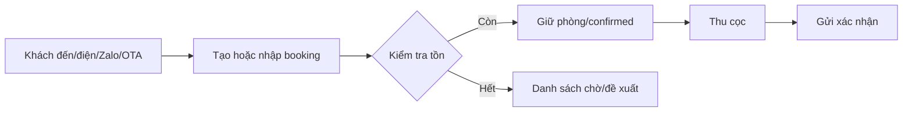
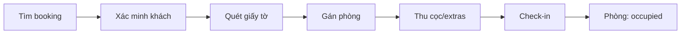
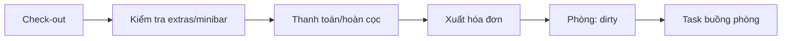

# Đặc tả hệ thống quản lý khách sạn độc lập

> Ngày lập: 02/11/2026.
> Tài liệu này dành cho **một sản phẩm riêng**, không phụ thuộc website tour Sea Trip Travel.
> Phần đồng bộ tồn phòng/OTA tham chiếu thêm `01-OTA-AVAILABILITY-RESEARCH.md`.

## 0. Kết luận ngắn

1. **Đừng làm native app ngay.** Làm web app responsive + PWA trước; cài được lên Android/iPhone từ trình duyệt, một codebase, cập nhật tức thời.
2. **Chỉ đóng gói native (Capacitor) khi cần lên CH Play/App Store, push ổn định, in hóa đơn nhiệt, hoặc tích hợp phần cứng.** Lúc đó vẫn dùng lại web app, không viết lại.
3. **MVP nên gồm:** đăng nhập/phân quyền, cấu hình khách sạn, loại phòng/giá, lịch tồn kho, đặt phòng, lễ tân check-in/out, khách, thanh toán cơ bản, buồng phòng cơ bản, báo cáo cơ bản, thông báo, PWA.
4. **Chưa làm ở MVP:** channel manager/OTA sync, kế toán đầy đủ, loyalty, POS, khóa từ, AI pricing, multi-property. Các phần này để phase sau.
5. **Ước lượng MVP một khách sạn:** 8–12 tuần cho 1 dev có kinh nghiệm; thêm OTA sync 4–8 tuần; thêm wrapper store 2–4 tuần.

---

## 1. Mục tiêu sản phẩm

Hệ thống giúp khách sạn nhỏ/vừa:

- Quản lý phòng, giá, tồn kho theo ngày.
- Nhận và quản lý đặt phòng từ nhiều nguồn.
- Làm thủ tục check-in/check-out nhanh.
- Theo dõi khách, thanh toán, hóa đơn.
- Điều phối buồng phòng.
- Xem báo cáo vận hành.
- Dùng trên điện thoại/máy tính bảng tại quầy lễ tân và khi đi công tác.

Không phải mục tiêu ban đầu:

- Thay thế toàn bộ phần mềm kế toán.
- Tích hợp khóa từ/phần cứng.
- Tự xây OTA.
- Chạy đa quốc gia/đa tiền tệ phức tạp.

---

## 2. Ai dùng hệ thống?

| Vai trò | Nhu cầu chính | Quyền gợi ý |
|---|---|---|
| Chủ khách sạn | Xem doanh thu, công suất, tình hình vận hành | Toàn quyền, xem báo cáo, cấu hình |
| Quản lý | Điều hành hằng ngày, giá, nhân viên, xử lý sự cố | Hầu hết quyền, trừ xóa dữ liệu |
| Lễ tân | Đặt phòng, check-in/out, thu tiền, đổi phòng | Đặt phòng, lễ tân, thanh toán, xem khách |
| Buồng phòng | Nhận task, cập nhật trạng thái phòng | Chỉ module buồng phòng |
| Kế toán | Đối soát, hóa đơn, báo cáo | Thanh toán, hóa đơn, báo cáo |
| Khách | Tự đặt phòng, xem/xác nhận | Chỉ booking engine, không vào admin |

Nguyên tắc: **mặc định từ chối**, cấp quyền theo vai trò, mọi thao tác nhạy cảm ghi audit.

---

## 3. Chức năng cần có

Phân loại MoSCoW:

- **Must**: MVP, thiếu thì không dùng được.
- **Should**: nên có sớm, sau MVP 1–2 phase.
- **Could**: có thì tốt, chưa cần.
- **Won't (now)**: không làm ở giai đoạn đầu.

### 3.1 Tổng quan

| Module | Must | Should | Could |
|---|---|---|---|
| Dashboard | Hôm nay, công suất, doanh thu, việc cần làm | Biểu đồ 7/30 ngày, cảnh báo bất thường | So sánh cùng kỳ, dự báo |
| Đặt phòng | Tạo/sửa/hủy, tìm kiếm, trạng thái | Đoàn/company, chia folio, đổi phòng | Chờ danh sách, tự động xếp phòng |
| Lịch/tồn kho | Lịch tháng, giá, đóng/mở, tồn | Kéo thả, bulk update, allotment | Revenue management |
| Lễ tân | Check-in/out, khách, phòng | Đăng ký lưu trú, chữ ký điện tử | Khóa từ, key card |
| Buồng phòng | Trạng thái phòng, task | Ảnh, kiểm tra, minibar | Điều phối tối ưu |
| Khách | Hồ sơ, lịch sử, ghi chú | Hạng khách, sinh nhật, blacklist | Loyalty |
| Thanh toán | Tiền mặt/chuyển khoản, thu/hoàn | Gateway, invoice, e-invoice | Đối soát tự động |
| Kênh/OTA | Nhập tay, iCal | Channel manager, ARI, reservation | Direct connectivity |
| Báo cáo | Công suất, doanh thu, nguồn | ADR/RevPAR, hủy, công nợ | BI nâng cao |
| Cài đặt | Khách sạn, phòng, giá, user | Template thông báo, backup | Multi-property |
| Mobile | PWA cài được, responsive | Push, camera, offline đọc | Native wrapper/store |

### 3.2 Dashboard

Must:

- Khách đến hôm nay, khách đi hôm nay, khách đang ở.
- Số phòng bán / tổng phòng, công suất hôm nay.
- Doanh thu hôm nay, tiền cần thu, tiền đã thu.
- Phòng đang dọn, phòng hỏng/bảo trì.
- Cảnh báo: overbooking, thanh toán chờ, đồng bộ lỗi, task quá hạn.
- Quick actions: tạo đặt phòng, check-in, walk-in.

Should:

- Biểu đồ công suất/doanh thu 7–30 ngày.
- Top nguồn khách, tỷ lệ hủy.
- So sánh tháng này/tháng trước.

### 3.3 Đặt phòng

Must:

- Tạo booking: ngày đến/đi, loại phòng, số phòng, người lớn/trẻ em, gói giá, nguồn, ghi chú.
- Tìm theo tên, số điện thoại, mã đơn, email.
- Danh sách + lọc theo trạng thái/nguồn/ngày.
- Sửa ngày, phòng, giá, thông tin khách.
- Hủy theo chính sách; ghi lý do; hoàn tiền nếu có.
- Trạng thái: `pending`, `confirmed`, `checked_in`, `checked_out`, `cancelled`, `no_show`.
- Kiểm tra trùng phòng/tồn kho khi lưu.
- Lưu lịch sử thay đổi.

Should:

- Đặt đoàn/công ty, nhiều phòng, nhiều loại phòng.
- Chia folio (công ty trả / khách trả).
- Đổi phòng, nâng hạng, gia hạn.
- Đặt cọc, thanh toán một phần.
- Ghi chú đặc biệt: tầng cao, giường phụ, đến muộn.
- Nguồn: direct, walk-in, Agoda, Booking, Airbnb, Traveloka, giới thiệu.

Could:

- Danh sách chờ khi hết phòng.
- Tự động gợi ý phòng trống.
- Booking template cho khách quen.

### 3.4 Lịch tồn kho và giá

Must:

- Lịch theo tháng/tuần; hàng là loại phòng, cột là ngày.
- Mỗi ô: còn bao nhiêu/tổng, giá, đóng/mở.
- Sửa một ngày hoặc hàng loạt ngày.
- Đóng bán, mở bán, giảm tồn (bảo trì/giữ phòng).
- Min stay, max stay, đóng nhận khách (CTA), đóng trả phòng (CTD).
- Giá cuối tuần/ngày lễ/theo mùa.
- Kiểm tra không cho bán âm.

Should:

- Kéo thả đặt phòng trên lịch.
- Copy giá/tồn từ khoảng này sang khoảng khác.
- Allotment riêng cho từng kênh.
- Buffer an toàn cho OTA.
- Lịch sử sửa giá.

Could:

- Gợi ý giá theo công suất.
- So sánh giá đối thủ.

### 3.5 Lễ tân

Must:

- Danh sách khách đến/đi/đang ở.
- Check-in: xác nhận khách, gán phòng, thu cọc, ghi chú.
- Check-out: kiểm tra extras, thu tiền, xuất hóa đơn, chuyển phòng sang `dirty`.
- Đổi phòng, gia hạn, trả phòng sớm.
- Walk-in: tạo khách + booking + check-in trong một luồng.
- In/email hóa đơn hoặc xác nhận.

Should:

- Quét CCCD/hộ chiếu bằng camera (OCR nếu có).
- Đăng ký lưu trú, chữ ký điện tử.
- Tách hóa đơn, thu một phần.
- Danh sách khách về muộn/chưa đến.
- Ca làm việc, bàn giao ca.

Could:

- Khóa từ/key card.
- Tự động gửi hướng dẫn nhận phòng.
- Check-in online trước.

### 3.6 Buồng phòng

Must:

- Trạng thái phòng: `clean`, `dirty`, `inspected`, `out_of_order`, `maintenance`.
- Danh sách phòng cần dọn theo tầng/ưu tiên.
- Giao task cho nhân viên.
- Cập nhật trạng thái từ điện thoại.

Should:

- Ảnh minh chứng, ghi chú.
- Kiểm tra minibar, đồ thất lạc.
- Task định kỳ/bảo trì.
- Thời gian hoàn thành, năng suất.

Could:

- Tối ưu tuyến dọn phòng.
- Đồng bộ thiết bị thông minh.

### 3.7 Khách/CRM

Must:

- Hồ sơ: tên, SĐT, email, quốc tịch, giấy tờ, ghi chú.
- Lịch sử đặt phòng, thanh toán.
- Tìm kiếm, gộp hồ sơ trùng.
- Đồng ý nhận marketing (opt-in).
- Mã hóa dữ liệu nhạy cảm.

Should:

- Sở thích, dị ứng, phòng yêu thích.
- Khách quen, sinh nhật, hạng khách.
- Blacklist/cảnh báo.
- Xuất/xóa dữ liệu theo yêu cầu.

Could:

- Loyalty điểm/thưởng.
- Chiến dịch win-back.

### 3.8 Thanh toán, hóa đơn

Must:

- Phương thức: tiền mặt, chuyển khoản, thẻ qua gateway, ví điện tử.
- Đặt cọc, thu trước, thu tại khách sạn, thu một phần.
- Ghi nhận thanh toán, hoàn tiền, công nợ.
- Folio: tiền phòng, extras, thuế, phí, giảm giá.
- Hóa đơn/receipt; in/email.
- Đối soát tiền mặt theo ca.

Should:

- VNPay/MoMo/ZaloPay/Stripe (chọn 1–2).
- Hóa đơn điện tử.
- Đối soát OTA prepaid/collect, hoa hồng.
- Báo cáo công nợ, công nợ quá hạn.
- Multi-currency (khách nước ngoài).

Could:

- Tự động nhắc nợ.
- Chia hóa đơn nhiều bên.
- Kết nối phần mềm kế toán.

Quan trọng: **không lưu số thẻ/CVV**. Dùng cổng thanh toán host-to-host hoặc tokenization. Nếu chưa có gateway, chỉ ghi nhận tiền mặt/chuyển khoản và đánh dấu “chưa thu”.

### 3.9 Kênh/OTA

Must (nếu chỉ quản lý nội bộ):

- Ghi nguồn đặt phòng.
- Nhập tay booking từ OTA.
- Đánh dấu đã đồng bộ/đối soát.
- Cảnh báo nếu tồn tay và tồn OTA lệch.

Should:

- iCal import/export cho nơi đủ điều kiện 1 phòng/loại.
- Channel manager (Channex/SiteMinder/Cloudbeds/ezCloud) để đẩy ARI và nhận reservation.
- Mapping room type/rate plan.
- Sync health, retry, log.
- Overbooking alert.

Could:

- Direct connectivity với OTA (chỉ khi quy mô lớn).
- Revenue management theo kênh.

Chi tiết kỹ thuật: xem `01-OTA-AVAILABILITY-RESEARCH.md`.

### 3.10 Báo cáo

Must:

- Công suất (occupancy).
- Doanh thu theo ngày/tháng.
- Doanh thu theo nguồn.
- Danh sách đặt phòng/hủy.
- Công nợ/thanh toán.
- Báo cáo ca.

Should:

- ADR (Average Daily Rate).
- RevPAR (Revenue per Available Room).
- Tỷ lệ hủy/no-show.
- Length of stay, lead time.
- Công suất theo loại phòng.
- Đối soát OTA/hoa hồng.

Could:

- So sánh cùng kỳ.
- Dự báo công suất/doanh thu.
- Export Excel/CSV, gửi email định kỳ.

Công thức:

```text
Occupancy = số đêm phòng đã bán / số đêm phòng có thể bán
ADR       = doanh thu phòng / số đêm phòng đã bán
RevPAR    = doanh thu phòng / số đêm phòng có thể bán
```

### 3.11 Cài đặt và quản trị

Must:

- Thông tin khách sạn: tên, địa chỉ, SĐT, giờ check-in/out, tiền tệ, múi giờ.
- Loại phòng, phòng vật lý, sức chứa, tiện nghi.
- Gói giá, chính sách hủy, thuế/phí.
- Người dùng, vai trò, quyền.
- Audit log.
- Backup/restore.
- Cấu hình thông báo.

Should:

- 2FA cho chủ/quản lý.
- Template email/Zalo/SMS.
- Cấu hình buffer, stale threshold, chính sách overbooking.
- Multi-property (nếu SaaS).

Could:

- SSO, phân quyền theo chi nhánh.
- Data retention tự động.
- API cho đối tác.

### 3.12 Thông báo

Must:

- Xác nhận đặt phòng cho khách.
- Thông báo đặt phòng mới/hủy cho lễ tân.
- Nhắc thanh toán.
- Nhắc khách đến.
- Cảnh báo overbooking/sync lỗi.

Should:

- Email + Zalo OA/ZNS + SMS (chọn theo chi phí).
- Push notification trên PWA/native.
- Template đa ngôn ngữ.
- Nhắc đánh giá sau khi trả phòng.

Could:

- Marketing tự động, win-back.
- Tích hợp chatbot.

### 3.13 Night audit (kiểm toán cuối ngày)

Nên có sớm, vì ảnh hưởng báo cáo và công nợ.

- Chốt ngày kinh doanh.
- Post tiền phòng cho khách đang ở.
- Đánh dấu no-show cho khách không đến.
- Đối soát tiền mặt/thẻ/chuyển khoản.
- Tạo báo cáo cuối ngày.
- Khóa sửa dữ liệu ngày cũ (trừ quản lý).

Với khách sạn rất nhỏ, có thể làm “đơn giản hóa”: chỉ chốt doanh thu ngày và no-show, chưa cần khóa sổ phức tạp.

---

## 4. Luồng nghiệp vụ chính

### 4.1 Đặt phòng



### 4.2 Check-in



### 4.3 Check-out



### 4.4 Hủy/no-show

- Hủy trước hạn: hoàn theo chính sách; giải phóng tồn.
- Hủy muộn/không đến: thu phí theo chính sách; đánh dấu `no_show`; giải phóng hoặc giữ phòng tùy quy định.
- Ghi lý do, người xử lý, số tiền hoàn.
- Không xóa booking; giữ lịch sử.

### 4.5 Đổi phòng/gia hạn

- Kiểm tra tồn phòng mới.
- Chuyển phòng trong cùng transaction.
- Cập nhật folio, giá, housekeeping.
- Ghi audit.

### 4.6 Nhận booking từ OTA

- Nếu có CM: webhook/poll → tạo booking → gán phòng → thông báo lễ tân.
- Nếu không có CM: nhập tay từ email/extranet → đối soát định kỳ.
- Nếu trùng/không đủ phòng: đánh dấu overbooking, cảnh báo, xử lý theo chính sách.

---

## 5. Màn hình và điều hướng

### 5.1 Desktop/tablet (quản lý)

Sidebar:

1. Tổng quan
2. Lịch phòng
3. Đặt phòng
4. Lễ tân
5. Buồng phòng
6. Khách
7. Thanh toán/Hóa đơn
8. Báo cáo
9. Kênh/Đồng bộ
10. Cài đặt

### 5.2 Mobile (lễ tân/buồng phòng)

Bottom navigation 4–5 mục:

- **Hôm nay**: việc cần làm, khách đến/đi.
- **Lịch**: tồn phòng/giá.
- **Đặt phòng**: tạo/tìm.
- **Buồng phòng**: task/trạng thái.
- **Thêm**: khách, thanh toán, báo cáo, cài đặt.

Quy tắc mobile:

- Nút hành động chính to, dễ bấm (tối thiểu 44×44 px).
- Form ngắn, chia bước; tránh bảng nhiều cột.
- Hiển thị trạng thái rõ: đã thu/ chưa thu, confirmed/pending.
- Cho phép gọi/Zalo/nhắn khách ngay từ booking.
- Hỗ trợ tiếng Việt có dấu; sau này thêm tiếng Anh.
- Chế độ sáng/tối; safe area cho iPhone.

---

## 6. Mô hình dữ liệu cốt lõi

```text
property
  ├── room_type
  │     ├── room (phòng vật lý)
  │     └── rate_plan
  ├── calendar_day (room_type + date: tồn, giá, đóng/mở)
  ├── reservation
  │     ├── reservation_night (room_type/rate_plan + date + rooms)
  │     ├── guest
  │     ├── folio
  │     └── payment
  ├── housekeeping_task
  ├── channel_connection / sync_event
  └── user / role / audit_log
```

Quy tắc:

- `reservation_night` là ledger tồn phòng; không lưu “còn lại” như cột dễ lệch.
- `calendar_day` override giá/tồn cho ngày cụ thể.
- `room` vật lý tách khỏi `room_type`; một booking có thể chưa gán phòng ngay.
- `folio` gom các khoản phải thu; `payment` ghi nhận tiền thực thu.
- `audit_log` ghi ai làm gì, trước/sau nếu cần.
- Nếu SaaS: mọi bảng có `property_id`/`tenant_id`, kiểm tra cách ly ở mọi query.

Chi tiết schema tồn phòng/booking: xem `01-OTA-AVAILABILITY-RESEARCH.md` mục 6.3.

---

## 7. Phạm vi MVP và lộ trình

### 7.1 MVP (8–12 tuần)

Làm trước:

- Đăng nhập, vai trò, audit cơ bản.
- Cấu hình khách sạn, loại phòng, phòng, gói giá.
- Lịch tồn kho/giá theo ngày.
- Đặt phòng + tìm kiếm + hủy.
- Lễ tân check-in/out, gán phòng.
- Hồ sơ khách cơ bản.
- Thanh toán tiền mặt/chuyển khoản; một gateway nếu cần.
- Hóa đơn/receipt đơn giản.
- Buồng phòng cơ bản.
- Dashboard + báo cáo cơ bản.
- Email/Zalo xác nhận.
- PWA cài được trên Android/iPhone.

Chưa làm:

- Channel manager/OTA sync.
- Night audit đầy đủ.
- Hóa đơn điện tử.
- Multi-property.
- Loyalty/POS/khóa từ.
- Native app store.

### 7.2 Các phase

| Phase | Nội dung | Thời lượng gợi ý |
|---|---|---|
| 0 | Khảo sát 1 khách sạn pilot, chốt quy trình, mẫu hóa đơn, quyền | 1 tuần |
| 1 | Nền tảng: auth, property, phòng, giá, lịch, booking, lễ tân | 4–6 tuần |
| 2 | Thanh toán, hóa đơn, khách, buồng phòng, báo cáo, PWA | 3–4 tuần |
| 3 | Channel manager/OTA, đối soát, overbooking | 4–8 tuần |
| 4 | Night audit, e-invoice, Zalo OA, template, phân quyền nâng cao | 3–5 tuần |
| 5 | Native wrapper (Capacitor), store, push, camera, in nhiệt | 2–4 tuần |
| 6 | Multi-property/SaaS, billing, Postgres, observability | 8–12 tuần |

Ước lượng cho 1 dev quen stack, chưa tính thời gian chờ đối tác/duyệt store. Cộng 30–50% buffer.

### 7.3 Thứ tự ưu tiên nếu thời gian ít

1. Lịch + booking + check-in/out.
2. Thanh toán + hóa đơn.
3. Buồng phòng + báo cáo.
4. PWA.
5. OTA sync.
6. Native store.

---

## 8. Mobile app: PWA hay native?

### 8.1 So sánh

| Tiêu chí | PWA | Capacitor wrapper | React Native/Flutter |
|---|---|---|---|
| Một codebase với web | Có | Có (bọc web) | Không, viết lại |
| Cài trên Android | Chrome → Install | APK/AAB, CH Play | CH Play |
| Cài trên iPhone | Safari → Add to Home Screen | IPA, App Store | App Store |
| Cập nhật | Tức thời, không qua store | Qua store (hoặc OTA web) | Qua store |
| Push | Android tốt; iOS cần cài + iOS 16.4+ | Tốt, native | Tốt |
| Camera/quét giấy tờ | Được, chất lượng tùy | Tốt hơn | Tốt |
| Offline | Hạn chế, iOS dễ xóa storage | Tốt hơn (SQLite) | Tốt nhất |
| In hóa đơn nhiệt | Không (trừ print service) | Có plugin/bridge | Có |
| Khóa từ/phần cứng | Không | Có bridge | Có |
| Store review | Không có | Có, có thể bị từ chối nếu chỉ bọc web | Có |
| Chi phí | Thấp | Trung bình | Cao |
| Phù hợp | MVP, nhân viên, chủ | Khi cần store/hardware | Mobile-first, offline nặng |

### 8.2 Khuyến nghị

**Giai đoạn 1: PWA.**

- Dùng chung web app responsive.
- Cài lên điện thoại/máy tính bảng, có icon, chạy toàn màn hình.
- Không cần CH Play/App Store.
- Phù hợp lễ tân, buồng phòng, chủ khách sạn.

**Giai đoạn 2: Capacitor.**

- Khi cần:
  - có mặt trên CH Play/App Store;
  - push ổn định;
  - quét giấy tờ tốt hơn;
  - in hóa đơn nhiệt;
  - offline tốt hơn;
  - tích hợp khóa từ/thiết bị.
- Bọc chính web app, thêm plugin native; không viết lại UI.

**Chỉ dùng React Native/Flutter nếu:**

- App mobile là sản phẩm chính, không cần web admin.
- Cần offline nặng, nhiều tương tác phần cứng.
- Có đội mobile riêng.

### 8.3 Cách cài PWA

Android (Chrome):

1. Mở website bằng Chrome.
2. Menu ⋮ → **Install app** hoặc **Add to Home screen**.
3. Mở từ icon; chạy như app.

iPhone (Safari):

1. Mở website bằng Safari.
2. Nút Share → **Add to Home Screen**.
3. Mở từ icon.
4. Push chỉ hoạt động khi đã cài vào màn hình chính, iOS 16.4+.

Lưu ý:

- iOS không có prompt cài tự động; phải hướng dẫn.
- PWA không lên App Store/CH Play.
- iOS có thể giới hạn storage/background sync.
- In nhiệt, khóa từ, Bluetooth: cần native wrapper.
- Nếu chỉ bọc web mà không thêm giá trị native, App Store có thể từ chối theo guideline 4.2 (minimum functionality). Cần push/camera/offline/biometric để đủ chất.

### 8.4 Yêu cầu kỹ thuật PWA

- HTTPS.
- `manifest.webmanifest`: tên, icon 192/512, maskable, theme, display `standalone`, start_url.
- Service worker: cache shell, offline page, cache dữ liệu “hôm nay” có kiểm soát.
- IndexedDB cho dữ liệu offline/queue; không dùng localStorage cho PII.
- Web Push (VAPID/FCM); iOS cần cài trước.
- Share target, app shortcuts (tạo booking, check-in).
- Safe area, touch target, chống zoom form trên iOS.
- Màn hình offline: xem việc hôm nay, hàng đợi đồng bộ, trạng thái.
- Queue writes có idempotency; không cho tạo booking offline nếu chưa kiểm tra tồn? Có thể cho “pending offline” và xác nhận lại khi online, nhưng phải cảnh báo.
- Không cache dữ liệu nhạy cảm quá lâu; có nút xóa cache/đăng xuất.

### 8.5 Giới hạn cần nói trước với khách sạn

- PWA không phải app store; nếu khách yêu cầu “tải trên CH Play” thì phải làm wrapper.
- Offline không đảm bảo 100%; nghiệp vụ check-in offline cần quy trình giấy dự phòng.
- Push iOS có thể chậm/không đến nếu người dùng tắt thông báo.
- In hóa đơn nhiệt cần native/print service.
- Camera quét giấy tờ trên PWA phụ thuộc thiết bị/ánh sáng; OCR có thể sai.

---

## 9. Kiến trúc kỹ thuật gợi ý

### 9.1 Nếu một khách sạn, chạy VPS

```text
Next.js (web + API + PWA)
  ├── SQLite/Postgres
  ├── Object storage (ảnh, giấy tờ)
  ├── Queue/outbox (email, sync)
  └── Payment gateway
```

- Giống mô hình hiện tại của Sea Trip nhưng **repo/app riêng**, DB riêng.
- SQLite đủ cho một khách sạn, một instance; backup daily.
- Nếu cần nhiều người dùng đồng thời/online 24/7, cân nhắc Postgres ngay từ đầu.

### 9.2 Nếu SaaS nhiều khách sạn

```text
Next.js (admin + booking engine + API)
  ├── Postgres (multi-tenant, RLS)
  ├── Redis/queue (job, sync)
  ├── Object storage
  ├── Payment gateway
  ├── Email/Zalo/SMS
  └── Channel manager adapter
```

- `tenant_id`/`property_id` từ đầu.
- Phân quyền theo property.
- Audit, backup, observability.
- Không dùng SQLite cho multi-instance.

### 9.3 Stack gợi ý

- **Web/app:** Next.js + React + TypeScript + Tailwind (bạn đã quen).
- **DB:** Postgres (Neon/Supabase/RDS) cho SaaS; SQLite cho single property.
- **ORM:** Drizzle hoặc Prisma.
- **Auth:** Auth.js/Clerk/Supabase Auth; 2FA; passkey.
- **UI:** shadcn/ui hoặc component kit hiện có; ưu tiên mobile.
- **PWA:** Serwist/Workbox; IndexedDB/Dexie.
- **Native wrapper:** Capacitor.
- **Queue:** Inngest/BullMQ/Postgres outbox.
- **Payment:** VNPay/MoMo/ZaloPay/Stripe.
- **Email:** Resend/SES/SMTP.
- **Zalo:** Zalo OA/ZNS.
- **Observability:** Sentry + uptime + log.
- **Backup:** daily DB + storage; restore test.

Không cần Redis/queue ở MVP nếu lưu lượng thấp; outbox trong DB là đủ.

---

## 10. Bảo mật, thanh toán, pháp lý

- **Phân quyền:** kiểm tra ở server, không chỉ ẩn nút.
- **Cách ly dữ liệu:** tenant A không đọc được tenant B; test tự động.
- **PII:** mã hóa giấy tờ/SĐT/email; hạn chế log; retention; quyền xóa.
- **Thẻ:** không lưu số thẻ/CVV; dùng gateway/tokenization; PCI DSS.
- **Audit:** ai sửa giá, hủy đơn, hoàn tiền, xóa khách.
- **Backup:** mã hóa; kiểm tra restore định kỳ.
- **2FA:** bắt buộc cho chủ/quản lý; khuyến khích lễ tân.
- **Rate limit:** login, booking, tra cứu.
- **Webhook:** verify chữ ký, timestamp, replay.
- **Pháp lý:** hóa đơn điện tử, khai báo lưu trú, bảo vệ dữ liệu cá nhân, điều kiện kinh doanh lưu trú; kiểm tra với kế toán/luật sư.
- **OTA:** hợp đồng, rate parity, hoa hồng, hủy/hoàn, trách nhiệm khách.

---

## 11. Tiêu chí nghiệm thu MVP

- [ ] Tạo khách sạn, 10 loại phòng, 30 phòng vật lý, 365 ngày lịch.
- [ ] Lễ tân tìm booking theo SĐT trong < 5 giây.
- [ ] Check-in một khách trong < 30 giây; check-out < 60 giây.
- [ ] 20 request đặt 1 phòng cuối → đúng 1 thành công.
- [ ] Hủy/đổi phòng trả tồn đúng, có audit.
- [ ] Thanh toán tiền mặt/chuyển khoản; hoàn cọc; hóa đơn in/email.
- [ ] Buồng phòng cập nhật trạng thái từ điện thoại.
- [ ] Dashboard đúng số khách đến/đi/đang ở.
- [ ] Báo cáo công suất/doanh thu theo ngày/tháng.
- [ ] PWA cài được trên Android và iPhone; có màn hình offline.
- [ ] Push/email xác nhận booking hoạt động.
- [ ] Phân quyền: lễ tân không xóa được user/sửa cấu hình.
- [ ] Backup/restore có kiểm chứng.
- [ ] Không lưu số thẻ/CVV.
- [ ] Có test tự động cho tồn kho, booking, hủy, phân quyền.

---

## 12. Câu hỏi cần chốt trước khi code

1. Một khách sạn hay SaaS nhiều khách sạn?
2. Bao nhiêu phòng/loại phòng? Có nhiều phòng cùng loại không?
3. Có cần đồng bộ Agoda/Booking ngay phase 1 không?
4. Khách sạn đang dùng PMS/channel manager nào?
5. Có cần đặt phòng online cho khách không, hay chỉ nhân viên nhập?
6. Thanh toán: tiền mặt/chuyển khoản/gateway nào?
7. Có cần hóa đơn điện tử/khai báo lưu trú không?
8. Có cần in hóa đơn nhiệt/khóa từ không?
9. Có cần app trên CH Play/App Store ngay không?
10. Có cần offline khi mất mạng không? Mất bao lâu?
11. Ngôn ngữ: Việt/Anh? Có khách nước ngoài?
12. Ai vận hành/support ngoài giờ?

Nếu chưa chốt 1–3, chưa nên cam kết kiến trúc multi-tenant/OTA.

---

## 13. Tóm tắt một trang

- **Sản phẩm:** PMS nhẹ + booking management cho khách sạn nhỏ/vừa, tách hoàn toàn khỏi web tour.
- **MVP:** lịch tồn kho, đặt phòng, lễ tân, khách, thanh toán cơ bản, buồng phòng, báo cáo, PWA.
- **Mobile:** PWA trước (cài từ Chrome/Safari); Capacitor sau nếu cần store/push/in nhiệt/offline nặng.
- **Không làm ngay:** OTA sync, native app, multi-property, loyalty, POS.
- **Thứ tự:** MVP 8–12 tuần → OTA sync 4–8 tuần → native wrapper 2–4 tuần → SaaS 8–12 tuần.
- **Nguyên tắc:** một nguồn sự thật cho tồn phòng; không lưu thẻ; audit mọi thay đổi; mobile-first; đo trước khi hứa realtime.
